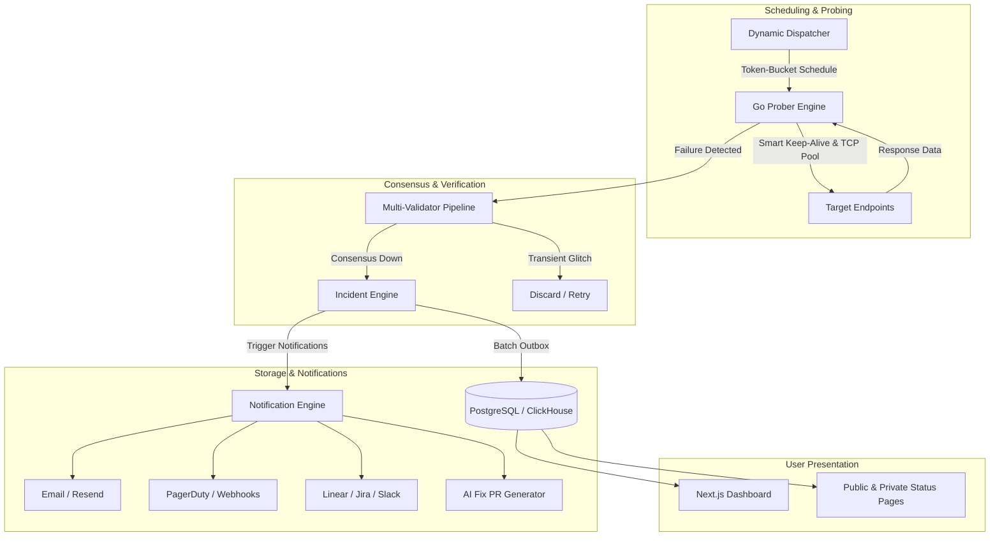

# Uptimer Bot — Comprehensive Feature Specification & Platform Documentation

---

## Executive Overview

**Uptimer Bot** is a high-performance, enterprise-grade synthetic monitoring and observability platform designed to scale from small developer workloads up to **1,000,000 monitors at 30-second intervals (33,333 checks/sec continuous throughput)**. 

The system blends an asynchronous, low-overhead Go probing engine with a Node.js/PostgreSQL/ClickHouse management layer and a Next.js real-time dashboard.



---

## 1. Multi-Protocol Monitoring (8 Supported Types)

Uptimer Bot natively implements 8 specialized monitoring engines. Each monitor type is configured with custom timeouts (5s to 60s), intervals (10s to 3,600s), tags, and group assignments.

| Monitor Type | Target Input | Primary Use Case | Key Differentiator |
| :--- | :--- | :--- | :--- |
| **HTTP / HTTPS** | URL (`http://`, `https://`) | Web servers, REST APIs, microservices | Smart Keep-Alive, HTTP methods, headers, payload |
| **Keyword** | URL + Target String | Content integrity, frontend validation | Case-sensitivity control, inverted matching rules |
| **API Assertions**| URL + JSON / JMESPath | Complex JSON APIs, payloads, contracts | Sandboxed worker execution, 6 assertion operators |
| **ICMP Ping** | Hostname / IP address | Network infrastructure, VPS, bare-metal | Sub-millisecond latency & packet-loss tracking |
| **TCP Port** | Hostname + Port | Databases, SSH, Redis, Mail, Kafka | Direct socket SYN/ACK handshake validation |
| **UDP** | Host + Port + Payload | DNS, SNMP, streaming services | Binary datagrams, SNMP sysUpTime, expected replies |
| **DNS** | Domain + Nameserver | Authoritative DNS, Zone changes, CDNs | All 8 record types, authoritative vs. custom resolver |
| **Heartbeat** | Secret Webhook URL | Cron jobs, worker daemons, backups | Dead Man's Snitch, grace period, atomic token rotation |

---

### Detailed Protocol Configurations

#### 1.1. HTTP / HTTPS Monitor
- **HTTP Methods:** `GET`, `HEAD`, `POST`, `PUT`, `PATCH`, `DELETE`.
- **Status Code Matchers:** Flexible status matching including `2xx`, `3xx`, or comma-separated lists (e.g. `200, 201, 204`).
- **Redirects:** Configurable `follow_redirects` with loop protection.
- **Authentication:**
  - `None`
  - `Basic Auth` (Username & Password encrypted with `pgcrypto`)
  - `Bearer Token` (Header injected securely)
- **Custom Payloads:** Custom headers (JSON array of key-value pairs) and custom body payload (optional `send_as_json` flag).
- **IP Stack Priority:** `auto_ipv4_priority`, `force_ipv4`, or `force_ipv6`.

#### 1.2. Keyword Monitor
- Checks presence or absence of specific text in the HTTP body.
- **Conditions:** `contains` or `does_not_contain`.
- **Case Sensitivity:** Case-sensitive or case-insensitive matching toggle.
- Avoids false alarms on empty error pages returning `HTTP 200`.

#### 1.3. API & JSON Assertion Monitor
- Designed for deep API contract and schema testing.
- **JSON Path Extraction:** Dot notation (e.g. `data.user.id`) and advanced JMESPath queries.
- **Comparison Operators:**
  - `equals`
  - `not_equals`
  - `contains`
  - `greater_than`
  - `less_than`
  - `matches_regex`
- **Assertion Logic:** `all_must_pass` (AND) or `any_must_pass` (OR).
- **Security Sandboxing:** Regex and JMESPath executions run in isolated worker threads with a strict 500 ms execution ceiling to prevent ReDoS.
- **Payload Protection:** Configurable body size limits (default 512 KB) to guard against memory exhaustion.

#### 1.4. ICMP Ping Monitor
- Direct OS-level or raw socket ICMP echo requests.
- Configurable packet count and individual packet timeout.
- Records minimum, average, and maximum Round-Trip Time (RTT) alongside packet loss percentages.

#### 1.5. TCP Port Monitor
- Establishes a raw TCP handshake without sending higher-level application payloads.
- Verifies listening states of critical services (PostgreSQL `5432`, Redis `6379`, MySQL `3306`, SSH `22`, etc.).
- Measures connect latency in milliseconds.

#### 1.6. UDP Monitor
- **DNS Probe:** Sends a standard UDP DNS query to port 53.
- **SNMP Probe:** Sends an SNMPv2c `sysUpTime` query (`1.3.6.1.2.1.1.3.0`) with custom SNMP community strings.
- **Raw UDP Datagram:** Transmits arbitrary ASCII or hexadecimal buffers with an option to await an expected reply or succeed immediately upon packet egress.

#### 1.7. DNS Record & Integrity Monitor
- **Supported Records:** `A`, `AAAA`, `CNAME`, `MX`, `NS`, `TXT`, `SOA`, `SRV`.
- **Resolver Routing:**
  - `authoritative`: Resolves directly against the domain's authoritative nameservers.
  - `custom`: Queries designated public or corporate resolvers (e.g., `1.1.1.1`, `8.8.8.8`, internal DNS).
- **Match Modes:** `exact_set`, `contains`, `any_match`.
- **Error Diagnostics:** Categorizes `NXDOMAIN`, `ENODATA`, `SERVFAIL`, and `ETIMEDOUT`.

#### 1.8. Heartbeat / Dead Man's Snitch Monitor
- Inverted push-based monitoring for periodic cron jobs and backup scripts.
- **Unique Heartbeat URL:** Targets send HTTP `GET` or `POST` pings upon job completion.
- **Grace Periods:** Configurable safety buffer (e.g., 5-minute schedule with a 60-second grace window).
- **Atomic Compare-and-Swap (CAS):** Background detection engine runs every 10s using atomic database updates to avoid race conditions with arriving pings.
- **Dual-Token Zero-Downtime Rotation:** Maintains `heartbeat_token` and `heartbeat_token_previous` so tokens can be rotated without breaking active cron jobs.

---

## 2. High-Performance Core Engine (1M Scale Architecture)

The Go prober engine is optimized for high-volume network efficiency:

```text
+------------------------------------------------------------------+
|                    Go Prober Core Architecture                   |
|                                                                  |
|  +--------------------+     +------------------+     +--------+  |
|  | Dynamic Dispatcher | --> | In-Memory DNS    | --> | Socket |  |
|  | (Wave Shaper)      |     | Cache (Async)    |     | Pool   |  |
|  +--------------------+     +------------------+     +--------+  |
|                                                           |      |
|  +--------------------+     +------------------+          v      |
|  | Outbox DB Batcher  | <-- | Zero-Copy Body   | <--  Epoll I/O  |
|  | (Postgres/CH)      |     | Reader & Decomp  |     Keep-Alive  |
|  +--------------------+     +------------------+                 |
+------------------------------------------------------------------+
```

- **Smart Keep-Alive Connection Pooling:**
  - Targets running at short intervals ($\le 30$s) maintain warm, persistent TLS connections, avoiding expensive asymmetric cryptographic handshakes.
  - Automatic detection switches low-frequency monitors ($>60$s) to cold dials to prevent idle server connection timeouts.
  - **Result:** Saves **~23% to 30% wire bytes** (reducing network egress by ~40 TB/month at 1M scale).
- **In-Memory Asynchronous DNS Cache:**
  - In-memory DNS cache with background TTL refreshing.
  - Prevents local DNS socket exhaustion and protects recursive resolvers from query floods.
- **Token-Bucket Dynamic Wave Dispatcher:**
  - Evenly spreads monitor execution across time windows, eliminating "top-of-minute" execution spikes.
- **Zero-Copy Body Streaming & Decompression:**
  - Reads only required bytes for keyword/header validation.
  - Native streaming support for `gzip`, `deflate`, `br` (Brotli), and `zstd`.
- **Asynchronous Outbox Logger:**
  - Flushes check logs in micro-batches directly to ClickHouse / PostgreSQL, bypassing row-by-row transaction locks.

---

## 3. False-Positive Elimination & Validation Engine

1. **Multi-Validator Consensus Pipeline:**
   - When a primary prober detects an endpoint failure, the check is immediately queued for secondary validation across distinct network voters.
   - A target is only transitioned to `DOWN` if consensus confirms the outage, preventing false alarms from local ISP drops.
2. **SSL / TLS Expiration & Health Monitoring:**
   - Tracks certificate validity, issuer chains, and expiration dates.
   - Configurable advance warning alerts (e.g. 30 days, 14 days, 7 days before certificate expiration).
   - Detects SSL cipher negotiation errors, expired certificates, self-signed chains, and hostname mismatches.
3. **Slow Response / Degraded State Detection:**
   - Monitors can specify an optional latency threshold (e.g. `slow_response_threshold_ms = 1500`).
   - Flags degraded endpoints before complete service downtime occurs.

---

## 4. Incident Management & Diagnostics

- **Automated Incident Lifecycle:**
  - Automatically opens an incident upon confirmed downtime.
  - Automatically resolves incidents once consecutive successful health checks are recorded.
- **Root Cause Categorization:**
  - Detailed reason tracking: `http_error`, `timeout`, `connection_refused`, `dns_nxdomain`, `ssl_expired`, `assertion_failed`, `keyword_missing`.
- **Incident Activity Log:**
  - Stores a chronological event log for every incident:
    - Initial trigger time and error message.
    - Snapshot of response headers, status codes, and latency at time of failure.
    - Ongoing check evaluations during the outage.
    - Exact resolution timestamp and total downtime calculation.

---

## 5. Hosted Public & Private Status Pages

- **Custom Branding & Styling:**
  - Custom page titles, logos, brand colors, and unique vanity slugs (`/status/[slug]`).
- **Access Control:**
  - **Public:** Search-engine indexable, open to all users.
  - **Password-Protected:** Secured with bcrypt-hashed passwords and signed JWT session cookies.
- **Component & Monitor Mapping:**
  - Group monitors into logical customer-facing components (e.g., "Web App", "Payment Gateway", "API Services").
  - Drag-and-drop sort ordering.
- **Visual 90-Day Uptime Calendar Bars:**
  - Daily color-coded uptime indicators (Green / Yellow / Red) displaying 90-day availability history.
- **Real-Time Incident Banners:**
  - Automatically displays active notices and real-time degradation banners.

---

## 6. Maintenance Windows & Alert Suppression

- **Recurrence Models:**
  - **One-time:** Specific start timestamp and duration for scheduled maintenance or upgrades.
  - **Weekly Recurring:** Selected days of the week, start time (HH:MM), duration (1 to 1,440 minutes), and timezone.
- **Smart Alert Suppression:**
  - Probers continue recording metric data, but notification triggers (email, SMS, webhooks) are automatically muted.
  - Checks executed during maintenance are explicitly tagged with `suppressed_by_window_id` for reporting clarity.

---

## 7. Multi-Channel Alerting & Integrations

- **Transactional Email:** HTML-formatted failure and recovery reports powered by Resend.
- **Webhooks:** Generic JSON payloads with cryptographic signature verification.
- **PagerDuty:** Direct incident triggering (`trigger`) and automated resolution (`resolve`).
- **Issue Tracking Systems:**
  - **Linear:** Automatically creates actionable issues on failure.
  - **Jira:** Opens Jira tickets linked to designated engineering projects.
- **ChatOps:** Slack and Discord incoming webhook support.
- **TracePilot Autonomous AI Fixer:**
  - Integrates with the platform's AI agent to inspect server stack traces and automatically open **GitHub Fix Pull Requests** for application errors.

---

## 8. Dashboard, Analytics & Reporting

- **Availability & Health Metrics:**
  - High-precision uptime percentages over 24-hour, 7-day, and 30-day windows.
  - Mean Time Between Failures (**MTBF**) in hours.
  - Continuous "Up Since" duration clock.
- **Visual Sparkline Graphs:**
  - Real-time 90-check boolean sparklines embedded directly in monitor list tables.
- **Interactive Response Time Charts:**
  - Time-series charts with client-side window filtering (1h, 3h, 6h, 12h, 30d).
- **Operational Grouping & Filtering:**
  - Organize monitors into folders (`uptime_groups`).
  - Multi-tag support (`tags[]`) for microservice environments.
  - Full-text search and status filters (All, Up, Down, Paused).

---

## 9. Security & Enterprise Compliance

- **SSRF (Server-Side Request Forgery) Protection:**
  - Strict IP address validation engine blocking loops and private networks (`127.0.0.0/8`, `10.0.0.0/8`, `172.16.0.0/12`, `192.168.0.0/16`, `169.254.169.254` cloud metadata).
- **At-Rest Secret Encryption:**
  - All sensitive user credentials (passwords, bearer tokens, API keys) are encrypted using PostgreSQL `pgcrypto`.
- **Automated Data Retention & Pruning:**
  - High-frequency raw check logs are automatically pruned after a 12-hour rolling window.
  - Aggregated daily stats are saved in `uptime_daily_metrics`, ensuring fast dashboard queries while preventing storage bloat.

---

## 10. Database Architecture & Schema Summary

```text
+------------------------------------------------------------------------+
|                          PostgreSQL Data Model                         |
+------------------------------------+-----------------------------------+
| Table                              | Purpose                           |
+------------------------------------+-----------------------------------+
| uptime_monitors                    | Master configuration & state      |
| uptime_groups                      | Logical folder hierarchy          |
| uptime_checks_log                  | Rolling raw telemetry (12h TTL)   |
| uptime_daily_metrics               | Historical daily rollups (90d+)   |
| uptime_incidents                   | Incident lifecycle records        |
| uptime_incident_activity           | Audit log of status transitions   |
| uptime_status_pages                | Hosted status page configurations |
| uptime_status_page_monitors        | Component-to-monitor relationships|
| uptime_maintenance_windows         | One-time and recurring schedules  |
| uptime_maintenance_window_monitors | Target monitor bindings           |
+------------------------------------+-----------------------------------+
```

### Real-Time Change Notification Trigger
```sql
CREATE OR REPLACE FUNCTION notify_monitor_change() RETURNS trigger AS $$
BEGIN 
  PERFORM pg_notify('monitor_updates', json_build_object('action', TG_OP, 'id', COALESCE(NEW.id, OLD.id))::text); 
  RETURN NULL; 
END $$ LANGUAGE plpgsql;
```
Ensures prober engines update internal dispatch pools within **< 100 milliseconds** of any configuration change without requiring engine restarts.
